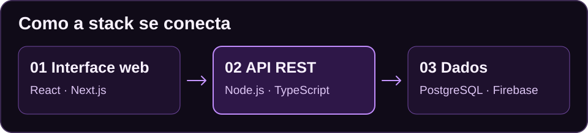
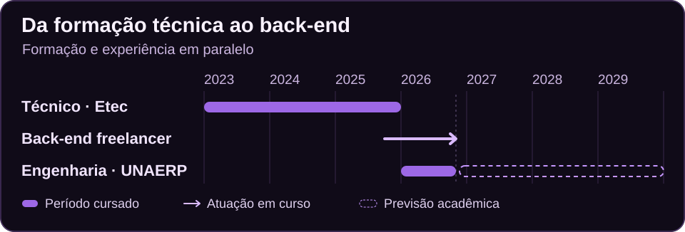

# Gabriel Ferreira Telles

**Desenvolvedor back-end freelancer · Estudante de Engenharia de Software na UNAERP**

Gosto de pensar no caminho que o dado percorre, da primeira requisição até o que aparece na tela. Desde outubro de 2025, atuo como freelancer desenvolvendo APIs REST, modelando dados e integrando aplicações web. Minha experiência com React e Next.js também me ajuda a entender como as decisões do back-end afetam quem implementa e usa a interface.

[**LinkedIn**](https://www.linkedin.com/in/gabriel-ferreira-telles/) · [**E-mail**](mailto:gabrielferreiratelles@gmail.com) · [**Repositórios**](https://github.com/GabrielFerreiraTelles?tab=repositories)

## 01 · Competências técnicas

| Área | Tecnologias e práticas | Como aplico |
| --- | --- | --- |
| **Back-end** | Node.js, TypeScript, JavaScript, Python, Go, APIs REST | Estruturo APIs e implemento a lógica que conecta aplicações a serviços e bancos de dados. |
| **Dados** | PostgreSQL, MySQL, MariaDB, Firebase, modelagem de dados | Modelo entidades e integro aplicações a bancos relacionais e serviços de dados como Firebase. |
| **Front-end** | React, Next.js, Tailwind CSS | Desenvolvo interfaces responsivas e conecto componentes a APIs. |
| **Ambiente e automação** | Docker, Linux, Shell Script | Containerizo aplicações e automatizo tarefas do ambiente de desenvolvimento. |
| **Versionamento e entregas** | Git, GitHub, Git Flow, Scrum, Kanban | Organizo mudanças e entregas em etapas, com atenção à legibilidade e à manutenção do código. |

## 02 · Projetos pessoais em desenvolvimento

| Projeto | O que estou explorando |
| --- | --- |
| **Observer** · coleta de eventos para e-commerce | Como receber eventos por pixel, SDK e integração com Shopify, usando um contrato comum para que os dados cheguem ao painel de forma consistente. |
| **Elyndor** · plataforma de narrativas interativas | Como estruturar um servidor para um mundo narrativo, persistir o progresso e conectar as ações do jogador ao estado da história. |

## 03 · Trajetória

| Marco | Período | Situação |
| --- | --- | --- |
| **Técnico em Desenvolvimento de Sistemas** · Etec Prof. José Ignácio Azevedo Filho | Jan. 2023 a dez. 2025 | Concluído |
| **Desenvolvedor back-end freelancer** | Desde out. 2025 | Em atividade |
| **Bacharelado em Engenharia de Software** · Universidade de Ribeirão Preto (UNAERP) | Desde jan. 2026 | Cursando · conclusão prevista para dez. 2029 |

**Idiomas** · Português nativo · Inglês intermediário (B1)

## 04 · O que estou aprofundando

- **Arquitetura de software** · Separação de responsabilidades e contratos claros entre módulos.
- **Automação e DevOps** · Ambientes reproduzíveis e rotinas de desenvolvimento com Docker e Linux.
- **Integração de dados** · Modelagem e consistência dos dados entre diferentes pontos de entrada.

## Vamos conversar?

Se você está desenvolvendo uma API, integrando serviços ou tirando uma aplicação web do papel, me encontre no [LinkedIn](https://www.linkedin.com/in/gabriel-ferreira-telles/) ou me escreva por [e-mail](mailto:gabrielferreiratelles@gmail.com).
